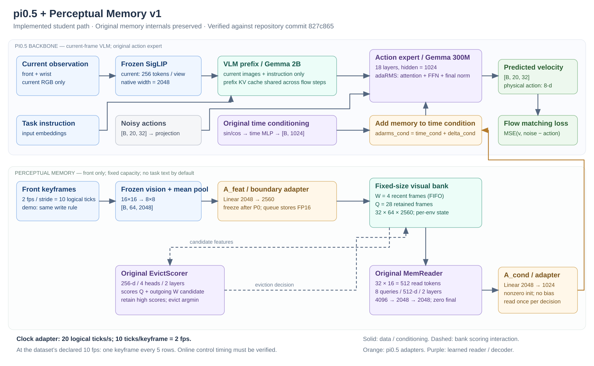

# π0.5 感知记忆 v1：实现与训练配置审阅

本次实现以提交 `827c86535fb3383488574ea683552454886fc344` 为基线，放在独立分支 `codex/pi05-perc-mem-v1`。服务器工作目录：`/mnt/cpfs/heping/projects/robomme_policy_learning_worktrees/perc_mem_v1_20261103`。原仓库 main 工作目录及其正在运行的 FrameSamp+Modul 复现配置没有改动。

**全量历史特征缓存已生成，P0 已在物理 GPU4–7 正式训练。** 本次提交包含 P0/P1/P2/P3 主线实现、训练配置，以及实际启动时发现的初始化和缓冲区捐赠修复。P1/P2/P3 尚未进行真实数据实验，闭环评测尚未运行。当前实验记录和重现入口见 [P0 运行记录](PERCMEM_V1_P0_RUN.md)。

## 1. 建议的审阅顺序

1. [P0 对标训练配置](../configs/train/robomme_percmem_v1_teacher_repro.yaml) 和 [记忆网络配置](../src/mme_vla_suite/models/config/robomme/perceptual-learned-adarms-v1-teacher.yaml)。
2. [π0.5 接入](../src/mme_vla_suite/models/integration/percmem_pi05.py)：`memory_condition`、`predict_velocity`、`sample_actions`。
3. [原规格 scorer / reader](../src/mme_vla_suite/models/representation/perc_memory_v1.py) 和 [确定性 W/Q 写入](../src/mme_vla_suite/shared/perc_mem_bank.py)。
4. [P3 学生配置](../configs/train/robomme_percmem_v1_student.yaml)、[P3 损失](../src/mme_vla_suite/models/integration/percmem_pi05.py)、[训练步骤及 EMA](../scripts/train.py)。
5. [新缓存/数据接口](../src/mme_vla_suite/training/lerobot_percmem.py)、[P1/P2/P3 离线工具](../src/mme_vla_suite/training/percmem_stages.py)、[策略部署](../src/mme_vla_suite/policies/percmem_policy.py)。

下图展示已接入的学生主路径；P0 老师读取全量已发生关键帧，跳过定长队列淘汰。



## 2. 与正在训练的复现配置对齐

参照文件：[robomme_framesamp_modul_repro.yaml](../configs/train/robomme_framesamp_modul_repro.yaml)。这份参照文件保持原样。

| 项目 | FrameSamp+Modul 复现 | 新 P0 全量老师 |
|---|---|---|
| 初始化 | 同一 pi05_base JAX/Orbax 参数 | 相同 |
| 基座 | gemma_2b + gemma_300m，BF16 计算 | 相同 |
| 视觉训练 | 冻结 img，当前图像仍在线编码 | 相同 |
| VLM/action 训练 | 全参，无 LoRA | 相同；新增 reader 与两适配层训练 |
| batch / FSDP / workers | 64 / 4 / 4 | 相同 |
| steps / seed | 80000 / 42 | 相同 |
| LR | warmup10000，随后5e-5恒定 | 相同 |
| AdamW | β1=.9、β2=.95、eps=1e-8、wd=0 | 相同 |
| clip / EMA | 1.0 / .999 | 相同；新分支 frozen 参数保持精确不变 |
| 保存 | 每10000步及最终步 | 相同周期；新 run 另存完整 train_state |
| 动作 | H=20，内部32维，物理8维；执行16步 | 相同 |
| 输入/归一化 | 双当前图像、任务指令、作者 norm_stats；discrete_state_input=false | 相同 |
| 历史特征 | 4×4、2048维、BF16 位模式，随时访问全部行 | 新建2fps关键帧的8×8、2048维原生 FP16 缓存 |
| 历史融合 | 每层 action→memory attention 调制 FFN | MemReader 全局向量加时间条件，进入18层及 final adaRMS |
| 运行目录 | 原 framesamp-modul run | 新 percmem-v1-teacher run |

P0 是原方案中必须先训练的全量记忆老师，因此历史读取预算大于32帧，不能将它写成与 FrameSamp+Modul 等记忆预算的最终成绩。真正固定预算32帧的模型是 P3 学生。

P3 配置沿用原方案的10%预算选项：8000步、LR5e-6、warmup1000；batch64和AdamW/EMA等仍相同。它从完成的 P0 初始化并蒸馏，不是一个从 pi05_base 随机 scorer 起步的80k新 run。比较训练总成本时必须包括 P0/P1/P2。

## 3. 模块和梯度路径

原内部尺寸保留：feature_dim2560；W=4、Q=28；store64、score/read各16 token；scorer256维/4头/2层；reader512维/8 queries/8头/2层；输出4096→2048→2048。输入适配2048→2560，输出适配2048→1024。

```text
native front features → A_feat → FP16 storage boundary → MemReader → c_mem[2048]
                                                                  ↓ A_cond
flow t → original pi0.5 time MLP → c_time[1024] + delta_mem[1024]
                                  ↓
              action expert 每层自己的 scale / shift / gate
                                  ↓
                           velocity[20,32]
```

默认 memory condition 进入原 adaptive RMSNorm；没有额外构建旧 MemoryAttention/MemoryRMSNorm，没有第三个 expert。sample 在 Euler 循环外只读一次记忆；每个 flow step 的时间条件继续变化。

Reader 最后2048→2048层零初始化；A_cond 非零 Xavier、无bias。因此初始模型与当前帧 π0.5 等价。P0 scorer 不参与动作损失并冻结；P3 冻结视觉/VLM/A_feat/scorer，只更新 reader、A_cond、action expert及其时间/action投影。

P3 明确传入独立的 full teacher bank 和 bounded student bank，共用一次当前图像预处理及一次冻结 VLM prefix。FM 与蒸馏使用同一 noisy action、flow time 和噪声；λ=1，均值 reduction 相同。teacher 参数作为独立 JAX 参数树传入，不捕获成编译器中的巨大常量。

原文未指定的实现细节固定为：LayerNorm eps1e-5；age sinusoid base10000；attention linear 含bias；reader age MLP为256→512→512、GELU。这些数值写在版本化配置/代码中，不声称来自原文。

按生产配置的 abstract 参数树统计（不等同于首步非零梯度量）：

| 部分 | 参数量 |
|---|---:|
| EvictScorer | 2,571,265 |
| MemReader | 22,720,000 |
| A_feat | 5,245,440 |
| A_cond | 2,097,152 |
| 新增合计 | 32,633,857 |

包含基座的总参数为3,386,067,729；P0优化器白名单中的参数为2,968,692,768。零初始化会使部分上游参数在首步暂时没有非零梯度，这与白名单统计不同。

## 4. 时间与精度协议

记忆时钟20Hz、stride10，即2fps。当前源数据标注10fps，因此选原始行0、5、10……；当前决策时刻单独保留，不以最近关键帧时刻代替。源 timestamp 必须与 VideoReader 使用的均匀视频时间相符，否则生成器报错，要求显式修正时间适配。

历史视觉使用共享的 `FrozenHistoryEncoder`：选定基座图像参数按训练器的冻结存储舍入为BF16，再以FP32计算；16×16 mean-pool到8×8，存FP16。离线、在线调用同一个编码函数。老师图像权重、原生缓存、A_feat、projected缓存、标签、scorer和bank之间核对身份，拒绝混用。

部署必须提供每帧 timestamp 或已核实的 control_hz。默认不从视频播放fps推断仿真控制周期。每个现有 Policy 实例管理一个环境；多环境应分配独立实例。P0有显式max_frames上限，超出时报错；学生W/Q长期容量固定。

P3 的冻结参数保留导出精度；EMA对这些参数直接保留当前值，避免 BF16 EMA 舍入导致视觉或scorer漂移。新分支将冻结参数单独作为不捐赠的 JIT 输入，仅捐赠可训练参数、对应 EMA 和优化器状态，避免共享冻结 params/EMA 的缓冲区在连续步骤中重复释放。旧变体继续使用原有行为。

## 5. 缓存、阶段产物与运行入口

新数据根目录：`/mnt/cpfs/heping/data/public/robomme_percmem_v1_cache`。旧50GB FrameSamp 4×4缓存只复用其已验证的数值索引来源，不作为新8×8特征使用，不覆盖旧特征。

| 阶段 | 入口 | 产物/要求 |
|---|---|---|
| 关键帧抽取 | `scripts/perc_mem/extract_keyframes.py` | 新manifest、真实timestamp、keyframe plan、FP16 native、视觉身份 |
| P0 | `scripts/run_percmem_profile.py` + teacher YAML | 全量老师；与复现版相同基座预算 |
| P1 | `scripts/perc_mem/build_labels.py` | 冻结 A_feat 的 projected 缓存、两层reader attention、后缀最大值u、未来出生mask |
| P1验证/回退 | 同入口，默认200锚点删高/低4帧；可选`--counterfactual` | 固定噪声/flow t；paired bootstrap95%下界>0才标记attention标签可信；回退须显式指定小数据范围 |
| P2 | `scripts/perc_mem/train_scorer.py` | 单独scorer；64轨迹batch、最多64排序对、margin.1、LR3e-4、wd.01、cosine、前30% oracle退火 |
| P3队列 | `scripts/perc_mem/rollout_banks.py` | 每个执行段锚点的成员列表；五种淘汰，完整时间/权重身份 |
| P3训练 | `scripts/run_percmem_profile.py` + student YAML | 冻结老师速度蒸馏；读取全量与定长两份bank |

所有新入口默认 review-only，需要显式 `--execute` 才做实际工作。P2 的总步数原文未指定，保留为执行时必须明确的 `--steps`；没有虚构一个“原方案默认值”。反事实标签的`--cf-scale`显式记录，默认1即原始ΔFM；如果量级不足以产生margin>.1的有效排序对，P2报错，不悄悄训练空损失。

P2 的训练日志区分混合 oracle/learned 调度指标与最终 learned-only replay 指标。当前数据沿用参照配置的1600个训练episodes，replay指标明确标注为训练集指标，不能作为held-out验证或闭环成功率。

主配置的仅审阅命令：

```bash
cd /mnt/cpfs/heping/projects/robomme_policy_learning_worktrees/perc_mem_v1_20261103
PERCMEM_PYTHON=/mnt/cpfs/heping/projects/robomme_policy_learning/.venv/bin/python
"$PERCMEM_PYTHON" scripts/run_percmem_profile.py \
  --config configs/train/robomme_percmem_v1_teacher_repro.yaml
```

P3 同一入口改为 `configs/train/robomme_percmem_v1_student.yaml`。当前 P0 配置使用物理 GPU4–7，原 FrameSamp+Modul 使用 GPU0–3；新 runner 从 profile 读取四个不同的物理设备 ID。P3 配置仍是阶段模板，运行前应选择空闲设备并准备完成的 P0 权重、P1 可信标签、P2 scorer 与 bank；runner 会检查阶段产物和 fresh-run 输出目录。

## 6. 保存与兼容边界

新 run 保存params/assets及完整train_state（包含非EMA训练参数、optimizer、step）；另固化 resolved history/model/profile 和 RNG推导协议。部署从checkpoint旁的resolved JSON读取，不依赖开发目录中后来修改的memory YAML；scorer随模型params保存。

目前仍只提供fresh-run配置。虽已保存optimizer，精确恢复DataLoader顺序/worker状态的路径没有实现，因此不宣称已经支持严格断点续训；原配置的resume/overwrite保护继续有效。

主线 `perc_adarms` 已实现。原方案的prefix融合是可选对照，本轮没有添加该融合分支。instruction-conditioned scorer的网络接口保留，默认关闭；其离线指令embedding产物需显式准备，现有在线策略对该可选模式明确报错，不将其描述为可直接部署的主线功能。

## 7. 验证范围

提交前 CPU 验证覆盖全部感知记忆测试和原 FrameSamp 回归，结果见 [验证报告](percmem_v1_validation.json)。新增的初始化回归实际执行 eval_shape→FSDP→jitted 初始化及连续三步训练，并核对冻结参数和 EMA 精确不变；另在微型四卡模型上复现并验证了共享冻结缓冲区的捐赠修复。生产基座 checkpoint 元数据与新模型的非记忆参数键名/形状全部兼容。

正式验证结果见 [验证报告](percmem_v1_validation.json)、[生产参数量与基座元数据兼容检查](percmem_v1_parameter_counts.json)。两份 CPU 配置解析报告 [P0](percmem_v1_teacher_review.json)、[P3](percmem_v1_student_review.json) 保留为启动前的初始审阅快照，其设备和缺失缓存信息不能代替当前配置及 [P0 实验记录](PERCMEM_V1_P0_RUN.md)。

覆盖：空间池化顺序；2000帧容量；候选自淘汰；随机可复现；10/20Hz时间映射；padding/全空记忆；reader零初始化及梯度解锁；scorer保存加载与配置一致性；实际小Gemma训练/采样等价性；单次reader采样调用；P1标签产物；一次真实P2 optimizer更新及确定性bank导出；双spawn worker读取mmap/真实小视频；未来帧拒绝；P3实际参数更新、teacher与冻结参数/EMA不变；完整train_state实际写盘；与参照训练配置逐字段比较。

生产模型已加载完整 pi0.5 真实权重，在 GPU4–7 完成四卡编译、batch64 显存验收和短程连续训练；全量原生历史特征缓存已生成。尚未完成 80k 训练、万步 checkpoint 验证、200 样本真实标签因果检验、真实 P1/P2/P3 实验或 RoboMME 闭环。测试中的 synthetic learned-only 指标仅用于验证代码路径，不能写成实验效果。

## 8. 来源

- 用户提供的原方案：`/Users/liam/Projects/research/MoMem-VLA/perc-mem-v1-design.md`。
- 本次已确认的迁移方案：`/Users/liam/Documents/ChatGPT/具身科研/pi05_perc_mem_v1_design/README.md`。
- 原仓库及复现配置：提交`827c86535fb3383488574ea683552454886fc344`及上文参照YAML。
- 代码的具体入口、张量尺寸和调制公式以上述实际实现为准，生产有效性以未来真实训练/评测为准。
